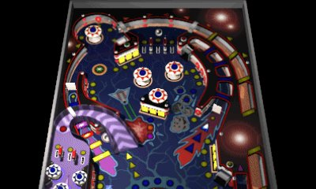
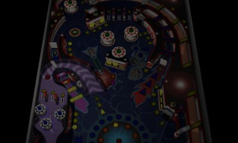
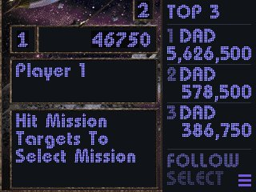
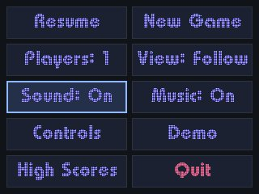

# Space Cadet Pinball for 3DS

The classic *Space Cadet* pinball table from old Windows PCs, rebuilt to play well on a New Nintendo 3DS.

The table fills the top screen, and a camera follows the ball as it moves. The bottom screen shows your score, the top high scores and a touch menu.

**Status:** finished. This is a personal project, shared as is. It does what I wanted, and I'm not planning updates or offering support.

## Screenshots

<table>
  <tr>
    <th>Playing</th>
    <th>Paused</th>
  </tr>
  <tr>
    <td align="center"></td>
    <td align="center"></td>
  </tr>
  <tr>
    <td align="center"></td>
    <td align="center"></td>
  </tr>
</table>

## What it does

- **The camera follows the ball.** The table is zoomed in so it's easy to see on the small screen. The view slides along with the ball and always shows the flippers when the ball comes down. Press **Select** to switch to the whole table at once.
- **Your score is on the bottom screen,** next to the top 3 high scores.
- **It keeps high scores.** When you beat one, you enter your initials like on an arcade machine. They're saved, so they're still there next time.
- **It has a touch menu.** Press **Start** to pause and open it. From there you can start a new game, choose 1–4 players, turn sound or music on and off, see all your high scores, or quit.
- **You can change the buttons.** Put the flippers, plunger and nudges on whichever buttons you like.
- **It looks the part.** Menus and scores use the game's own retro dot-matrix lettering.
- **It runs smoothly.** It plays at a steady 60 frames per second on a New 3DS.
- **It gets its own icon** on the HOME Menu.

## What you need

- **A New 3DS (or New 2DS XL) that can run homebrew.** It also starts on an original 3DS, but too slowly to play well. If your system isn't set up for homebrew yet, follow the [3DS Hacks Guide](https://3ds.hacks.guide).
- **FBI,** the app most homebrew setups use to install games. The guide above includes it.
- **The game files from a *Full Tilt! Pinball* CD,** or a copy of that disc. They aren't included here because they belong to the original makers.

## How to install

### 1. Download the game

Go to this repository's [**Releases**](https://github.com/imphuochuynh/SpaceCadetPinball-3DS/releases/latest) page and download **`SpaceCadetPinball.cia`**. That's the game.

### 2. Copy the files to your SD card

Turn off your 3DS, take out the SD card and put it in your computer.

1. **The game:** copy `SpaceCadetPinball.cia` into the **`cias`** folder on the SD card. Create the folder if it isn't there.
2. **The table and sounds:** open your *Full Tilt! Pinball* disc and find the **`CADET`** folder. On a Mac you can usually double-click a disc image to open it.
3. On the SD card, open the **`3ds`** folder and create a new folder in it named **`SpaceCadetPinball`**. The name has to match exactly.
4. Copy **`CADET.DAT`** from the disc into that new folder.
5. Make a folder named **`SOUND`** inside `SpaceCadetPinball`. Copy all the **`.WAV`** files from the disc's `CADET/SOUND` folder into it.

When you're done, the SD card should look like this:

```
SD card
├── cias
│   └── SpaceCadetPinball.cia
└── 3ds
    └── SpaceCadetPinball
        ├── CADET.DAT
        └── SOUND
            ├── SOUND1.WAV
            ├── SOUND3.WAV
            └── … (the rest of the .WAV files)
```

### 3. Install it on the 3DS

1. Put the SD card back and turn on your 3DS.
2. Open **FBI**, go to **SD → cias**, select **SpaceCadetPinball.cia**, and choose **Install and delete CIA**.
3. Return to the HOME Menu. **Space Cadet Pinball** is there. If you see a gift box, tap it to unwrap the icon.

### About the music

The game plays all its sound effects with just the files above. The background music is optional, and the disc stores it in an old format the 3DS can't play, so it has to be converted first. That takes some technical steps, described under **For developers** below. Without it the game simply has no background music.

## How to play

| What | Button |
|---|---|
| Left / right flipper | L / R |
| Launch the ball | Hold **A** to pull the plunger back, let go to launch |
| Nudge the table | D-Pad Left / Right / Up. Don't overdo it or you'll tilt! |
| Pause and open the menu | **Start**, or tap the ☰ icon on the bottom screen |
| Switch view (follow the ball / whole table) | **Select** |
| New game, after a game ends | **X** |

**To change buttons,** open the menu and choose **Controls**. Tap an action, then press the button you want for it. Start and Select can't be used, so you can always reach the menu.

**When you get a high score:** press Up/Down to pick each letter, and A to move to the next letter. Press A on the last letter to save.

## If something isn't working

- **There's no sound at all.** Your SD card needs a file called `dspfirm.cdc` in the `3ds` folder. Homebrew has no sound without it. If it's missing, run the [DSP1](https://github.com/zoogie/DSP1/releases) app once and it will create the file.
- **The game won't start, or closes right away.** Check that the folder is named exactly `SpaceCadetPinball` and that `CADET.DAT` is directly inside it, not in another folder.
- **Some sounds are missing.** Make sure all the `.WAV` files are inside the `SOUND` folder.
- **The icon doesn't appear.** Install the game again with FBI and look for a gift box on the HOME Menu.

## Credits

- **Original game:** Cinematronics and Maxis, published by Microsoft.
- **Reverse engineering of the game:** [k4zmu2a](https://github.com/k4zmu2a/SpaceCadetPinball). Their work recreated the game's code so it can run on other systems.
- **First 3DS version:** [MaikelChan](https://github.com/MaikelChan/SpaceCadetPinball/tree/3ds). This project builds on it.
- **This version:** [@imphuochuynh](https://github.com/imphuochuynh).

Free and open source under the MIT license, like the projects it's based on (see `LICENSE`). The game's art, sounds and music aren't included and still belong to their owners.

## AI disclosure

Everything new in this version was written with **Claude**, Anthropic's AI assistant. That includes the code, the tools and this README. I directed the project: I chose the features, made the design decisions, and tested every version on my own New 3DS until it played right. The projects it's built on were made by their authors, not by AI.

---

## For developers

Everything below is technical detail you don't need in order to play.

### Under the hood

- **Camera:** Follow view at about 1.75× zoom, on a critically damped spring. It leads a falling ball using a smoothed ball speed and clamps so the flippers stay fully in view.
- **Rendering:** only the 8×8 tiles of the game screen that changed are copied to the GPU each frame, into two textures used alternately. The original port re-sent the whole screen as a 2 MB texture every frame.
- **High scores:** the original 3DS port never recorded them. They're now saved the moment initials are entered.
- **Settings file:** everything is stored in `sdmc:/3ds/SpaceCadetPinball/settings.ini`. It's written to a temp file and then swapped in, so a crash can't wipe scores.
- **Font:** the table's own message font (`pbmsg_ft`) is packed into a GPU texture at startup and drawn with citro2d. If the data has no bitmap font, it falls back to the system font.
- **Plunger:** the pull-back now steps once per frame. The original 25 ms step landed on every second frame at 60 fps, which made it sluggish.
- **Separate title:** it installs as its own HOME Menu title (ID `0x5CADE`), beside the original port.
- **Frame meter:** open the menu and press **Y** to show average CPU ms per frame and a dropped-frame count in the bottom-screen footer.
- **XP data:** the Windows XP version (`PINBALL.DAT`, its `.WAV` files and `PINBALL.ogg`, all in `/3ds/SpaceCadetPinball/`) also loads. The layout was tuned on Full Tilt, though, and XP has no bitmap font for the themed text.

### Converting the music

Full Tilt stores its three tracks (`TABA1`–`TABA3`) as `.MDS` MIDI streams, and the 3DS build only plays OGG:

1. `tools/mds2mid.py` converts each track to standard MIDI. It's a Python port of the decompilation's own converter.
2. Render the MIDI with any General MIDI soundfont, and encode it at **22,050 Hz**, the game's audio rate. Any other rate makes the CPU resample continuously.
3. The silence trim in the ffmpeg command lets each track loop without a gap.

```bash
python3 tools/mds2mid.py TABA1.MDS TABA1.mid
fluidsynth -ni -F TABA1.wav -r 22050 -g 0.35 FluidR3_GM.sf2 TABA1.mid
ffmpeg -i TABA1.wav -af "silenceremove=stop_periods=1:stop_duration=1:stop_threshold=-60dB,alimiter=limit=0.85:level=false" \
       -ar 22050 -c:a libvorbis -q:a 4 TABA1.ogg
```

Repeat for TABA2 and TABA3, then put the three `.ogg` files in `/3ds/SpaceCadetPinball/SOUND/`.

### Building

**With GitHub Actions** (`.github/workflows/build.yml`), every push builds the `.cia` and `.3dsx`:
- The code compiles in the `devkitpro/devkitarm` container.
- The CIA is packaged on the host runner, because current `makerom` releases need a newer glibc than that container has. `.github/record-makerom.sh` records makerom's arguments inside the container so the host can replay them.

**Locally:**
- Install [devkitPro](https://devkitpro.org/wiki/Getting_Started) with `3ds-dev`, `3ds-sdl` and `3ds-sdl_mixer`, then run `make`.
- For a CIA, put [makerom](https://github.com/3DSGuy/Project_CTR/releases) and [bannertool](https://github.com/Epicpkmn11/bannertool/releases) in `$DEVKITPRO/tools/bin` and run `make BUILD_CIA=1`.

### Code map

New 3DS code lives in `SpaceCadetPinball/n3ds_*`:

| File | What it does |
|---|---|
| `n3ds_camera` | Follow / Classic views and spring-based ball tracking |
| `n3ds_ui` | Bottom-screen top-3 column and footer |
| `n3ds_menu` | Pause menu, plus the Controls, High Scores and confirmation pages |
| `n3ds_initials` | Arcade initials entry |
| `n3ds_controls` | Remappable buttons |
| `n3ds_font` | Packs the game's message font into a texture and draws text with citro2d |
| `n3ds_dirty`, `n3ds_tiles` | Track changed 8×8 tiles and copy them into GPU tile order |
| `n3ds_graphics` | citro3d setup; restores GPU state around citro2d drawing |

Off-device tools in `tools/`:

| Tool | Purpose |
|---|---|
| `mds2mid.py` | Full Tilt music to MIDI |
| `datdump.py` | Inspect `.DAT` files: background art, score-box and text-box positions |
| `ui_preview/preview.py` | Render the themed bottom-screen pages with the real game font |
| `camera_preview/` | Run the camera code natively: projected corners, table renders, and a jerk test on a simulated drop (needs citro3d's math sources compiled for your PC) |
| `tile_test/` | Checks the tile upload is byte-identical to the original port's swizzle |
